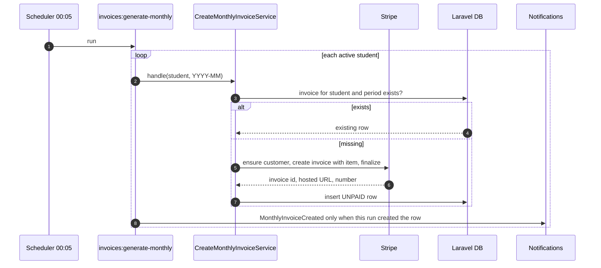
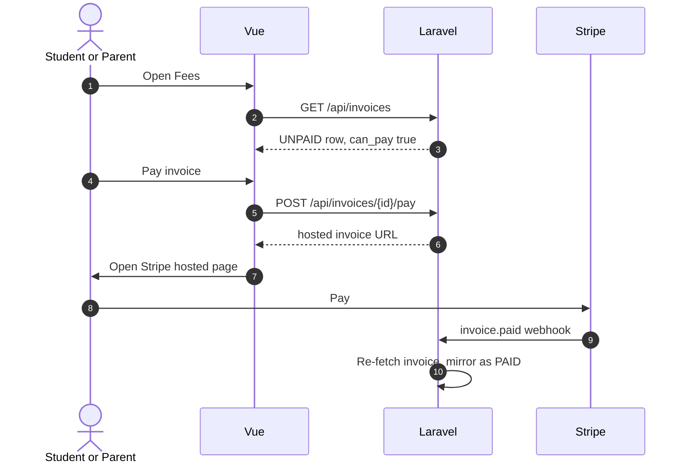

# Stripe Tuition Invoices — Implementation Guide

> **Purpose:** Each student gets **one ₱10,000 Stripe invoice per month**. It is due on the last day of that month and can be paid at any time. A scheduled job creates the invoices, notifies the student and the linked parent, and sends a reminder 3 days before the due date. Webhooks mirror Stripe's status back into Laravel. Vue lists the invoices and opens Stripe's hosted invoice page to pay.
>
> **Stack:** Laravel 12, Sanctum, Vue 3 (separate repo), `stripe/stripe-php`, Stripe Product and Price.
>
> **Replaces:** the earlier Subscriptions design. Subscriptions, Checkout, and the `tuition/*` endpoints were removed.

---

## 1. Decisions

| Decision | Choice |
| --- | --- |
| Who pays | The student, or the linked parent on the student's behalf |
| Amount | The Stripe Price on the tuition Product (`unit_amount`, ₱10,000). Not typed by the payer |
| Frequency | One invoice per student per **Asia/Manila** calendar month |
| Due date | Last day of the month, 23:59:59 Asia/Manila |
| When it can be paid | Any time after it is created (from the 1st) |
| Overdue | The invoice stays `UNPAID` after the due date. The Vue page marks it overdue |
| Partial payments | Not supported |
| Who creates invoices | Scheduled job `invoices:generate-monthly`, not lazy creation on page load |
| Stripe customer | One per student, stored in `students.stripe_customer_id` |
| Stripe's own invoice email | Off. `auto_advance` is `false`, so Stripe does not email. Our notifications are the only messages |
| Local `invoices` | Written when the invoice is created, with the Stripe invoice id and hosted URL. Webhooks keep it in sync |

---

## 2. What to install and configure

```bash
composer require stripe/stripe-php   # if not already installed
```

`.env` (see [.env.example](../.env.example)):

```dotenv
STRIPE_SECRET=sk_test_...
STRIPE_WEBHOOK_SECRET=          # empty locally until stripe listen
STRIPE_CURRENCY=php
STRIPE_PRODUCT_ID=prod_VcD2eMbWjPMlXe
STRIPE_PRICE_ID=                # optional; leave empty to use the product's default price
FRONTEND_URL=http://localhost:5173   # used for links in notifications
```

The amount comes from the Price. If `STRIPE_PRICE_ID` is not set, the default price of `STRIPE_PRODUCT_ID` is used. If neither resolves, the job fails with a clear error.

```bash
php artisan config:clear
php artisan migrate
```

Local webhook forward (only when testing webhooks; use the port your API actually listens on, often **8095** for Apache in this project):

```bash
stripe listen --forward-to http://localhost:8095/api/stripe/webhook
```

Put the printed `whsec_...` into `STRIPE_WEBHOOK_SECRET` for that test session, then `php artisan config:clear`.

### Scheduler

The server needs Laravel's scheduler running every minute:

```cron
* * * * * cd /path/to/weekly-dev && php artisan schedule:run >> /dev/null 2>&1
```

`MonthlyInvoiceCreated` and `InvoiceDueSoon` are sent immediately, not queued (they do not implement `ShouldQueue`). No queue worker is needed for them. If you add `ShouldQueue` later, the reminder command's failure handling no longer covers delivery errors, so run a queue worker and review that path first.

---

## 3. Timeline

| When (Asia/Manila) | What runs | What happens |
| --- | --- | --- |
| Every day, 00:05 | `invoices:generate-monthly` | For each **active** student with no invoice for the current month: creates the Stripe invoice, saves the local row as `UNPAID`, and notifies the student and the linked parent (`MonthlyInvoiceCreated`) |
| Every day, 08:00 | `invoices:remind-due` | For each `UNPAID` invoice due **3 days from today** that has not been reminded: sends `InvoiceDueSoon` to the student and the parent, then sets `reminded_at` |
| Any time | Student or parent clicks **Pay** | `POST /api/invoices/{id}/pay` returns Stripe's hosted invoice URL |
| Any time | Stripe sends webhooks | The invoice is mirrored as `PAID` (or `VOID` / `UNCOLLECTIBLE`) |
| Last day of month, 23:59:59 | Due date | Still `UNPAID` if not paid. The Vue page shows **Overdue** from the next day |

The generator runs every day, not only on the 1st. A student whose Stripe call failed on the 1st, or who became active later in the month, gets the invoice on the next run. Re-running the command for the same month never creates a second invoice.

### Command options

```bash
php artisan invoices:generate-monthly              # current Manila month
php artisan invoices:generate-monthly --month=2026-12
php artisan invoices:remind-due
```

`--month` must be `YYYY-MM`, or the command fails. Failures are logged per student. One failing student does not stop the run, and the command exits non-zero if any student failed.

---

## 4. Who does what

| Layer | Job |
| --- | --- |
| `invoices:generate-monthly` | Daily job. Creates missing monthly invoices and sends `MonthlyInvoiceCreated` |
| `invoices:remind-due` | Daily job. Sends `InvoiceDueSoon` once per invoice, 3 days before the due date |
| `CreateMonthlyInvoiceService` | Creates one period's invoice for one student. Returns the existing row if it is already there |
| `StripeCheckoutGateway` | Ensures the Stripe customer, reads the amount, creates and finalizes the Stripe invoice |
| `SyncStripeInvoiceService` | Mirrors Stripe invoices into `invoices` and records payments |
| `HandleStripeWebhookController` | Dispatches invoice events. Other event types are acknowledged with `200` |
| `PayStripeInvoiceService` | Returns the hosted invoice URL for a payable invoice |
| `PayOverdueInvoicesService` | Combines overdue unpaid invoices into one Stripe invoice, or returns the single overdue URL |
| `StripeInvoiceOperations` | Draft / void / finalize helpers for consolidation |
| `GetInvoicesService` | Lists invoices for a student or a parent's linked children |
| `GetParentChildrenService` | Lists the linked children for the parent selector |

---

## 5. Flowcharts

### 5.1 Monthly invoice creation



### 5.2 Payment



---

## 6. API contracts (Vue)

### `GET /api/parent/children`

Parents only. Lists the students linked to the logged-in parent so Fees can show a child selector.

```json
{
  "success": true,
  "data": [
    { "id": 7, "name": "Ana Student", "student_status": "1" }
  ]
}
```

`student_status` is the raw database value: `"1"` for active, `"0"` for inactive. Non-parents and parent users without a parent profile get `403 { "success": false, "message": "..." }`. (`GET /api/parents` lists every parent and is not for this purpose.)

### `GET /api/invoices?student_id=&page=&per_page=`

`student_id` is optional.

- Student: ignored; always the student's own invoices.
- Parent without `student_id`: invoices for all linked children.
- Parent with `student_id`: only that child's invoices. A student not linked to the parent returns `403 { "success": false, "message": "This student is not linked to your account." }`.

Rows are sorted oldest due date first. Invoices that were replaced by a combined overdue payment (`consolidated_into_id` set) are hidden. Each row includes `due_date`, `status`, `can_pay`, `is_overdue`, and `stripe_hosted_invoice_url`:

| `status` | Meaning | `can_pay` |
| --- | --- | --- |
| `UNPAID` | Stripe invoice is open. Past the due date it is still `UNPAID` and overdue | `true` once a hosted URL exists |
| `PAID` | Stripe invoice is paid (outstanding `0.00`) | `false` |
| `VOID` | Stripe invoice was voided (including originals replaced by Pay overdue) | `false` |
| `UNCOLLECTIBLE` | Stripe invoice was written off | `false` |

`is_overdue` is true when `status` is `UNPAID` and `due_date` is earlier than today in Asia/Manila.

`PARTIAL` still exists in the enum for old data but is never produced by the monthly flow.

### `POST /api/invoices/{id}/pay`

Response: `{ "success": true, "data": { "url": "https://invoice.stripe.com/..." } }`.

Allowed only when `status` is `UNPAID` and a hosted URL is present. Any other status returns a validation error (`This invoice is not payable.`). The caller must be the student or the linked parent, otherwise `403`.

### `POST /api/invoices/pay-overdue`

Body (parents): `{ "student_id": 1 }`. Students omit the body.

Response: `{ "success": true, "data": { "url": "https://invoice.stripe.com/..." } }`.

Only **overdue** unpaid invoices are included (due date before today in Asia/Manila). Current-month unpaid invoices are not.

- **None overdue:** `422` (`There are no overdue invoices to pay.`).
- **One overdue:** returns that invoice's hosted URL. No new Stripe invoice is created.
- **Two or more:** creates one combined Stripe invoice (due today + 7 days), voids the originals, marks them `VOID` with `consolidated_into_id`, and returns the combined hosted URL.

The combined invoice is created as a draft first, so it has no hosted URL until every original is voided. That blocks paying both an original and the combined invoice.

If a void fails partway (for example an original was paid during those few seconds), the service re-issues a replacement open invoice for each already-voided original, deletes the draft, and returns an error. Re-issued invoices use a due date of today + 7 days (Asia/Manila), because Stripe rejects past due dates. Stripe has no transactions, so a failed re-issue is logged as critical and needs a manual repair.

### Removed

- `GET /api/tuition/status`
- `POST /api/tuition/subscribe`

Both routes were removed with the subscription flow.

---

## 7. Data

Migrations (in order, for the invoice model):

1. `2026_11_13_052700_add_stripe_subscription_columns_to_billing_tables.php` (earlier)
2. `2026_11_18_100000_add_void_and_uncollectible_to_invoice_status.php` (earlier)
3. `2026_11_20_090000_add_monthly_invoice_columns.php`
4. `2026_11_24_210000_add_consolidated_into_id_to_invoices_table.php`

| Table | Columns | Notes |
| --- | --- | --- |
| `students` | `stripe_customer_id` | New. Unique, nullable. One Stripe customer per student |
| `students` | `stripe_subscription_id`, `stripe_subscription_status` | Left in place, now unused. Dropping them is a separate change |
| `invoices` | `billing_period` (`YYYY-MM`) | New. Unique with `student_id`. One invoice per student per month. Combined overdue invoices leave this null |
| `invoices` | `consolidated_into_id` | New. Self FK. Set on originals replaced by Pay overdue |
| `invoices` | `reminded_at` | New. Set once when the 3-day reminder is sent |
| `invoices` | `stripe_invoice_id`, `stripe_hosted_invoice_url` | Existing. Written when the invoice is created |
| `payments` | `stripe_invoice_id` | Existing. Written by the webhook sync |

---

## 8. Webhooks

Enable these events for the endpoint:

- `invoice.created`
- `invoice.finalized`
- `invoice.updated`
- `invoice.paid`
- `invoice.payment_succeeded`

Route: `POST /api/stripe/webhook` (no Sanctum; CSRF exempt). Other event types, including subscription and checkout events, are acknowledged with `200` and ignored.

### How the handler stays correct

- **Fresh state, not the payload.** For each invoice event the handler re-fetches the invoice from Stripe by id and mirrors that. A deleted draft (404) is ignored.
- **No downgrade.** A local `PAID` invoice is never set back to `UNPAID` by a stale event.
- **Student from metadata.** The monthly invoice carries `metadata.student_id` and `metadata.billing_period`. Older subscription invoices still resolve through their subscription, and the legacy path is kept on purpose so those retries do not loop.
- **Webhook and job can race.** Stripe sends `invoice.created` and `invoice.finalized` as soon as the job creates the invoice, so the webhook may mirror it before the job saves its own row. The webhook creates rows without a `billing_period`. `CreateMonthlyInvoiceService` therefore looks up the row by `stripe_invoice_id` first and assigns the period to it, and it treats that row as newly created so the "new invoice" notification is still sent once. If the webhook arrives after the job's insert, it just updates the existing row.
- **Refunds are not tracked.** Refunding a payment in the Stripe Dashboard does not change the invoice status in Stripe or locally. The invoice stays `PAID`.
- **Payments record what was charged.** The `payments` row uses Stripe `amount_paid`, not the invoice total.
- **Errors trigger retries.** If the database rejects a write, the handler returns `500` so Stripe retries. Invoices with no resolvable student (manual Dashboard invoices) are ignored with `200`.

---

## 9. Class map

| Class | Path |
| --- | --- |
| `GenerateMonthlyInvoices` (`invoices:generate-monthly`) | `app/Console/Commands/` |
| `RemindDueInvoices` (`invoices:remind-due`) | `app/Console/Commands/` |
| `CreateMonthlyInvoiceService` | `app/Services/Payment/` |
| `StripeCheckoutGateway` | `app/Services/Payment/` |
| `SyncStripeInvoiceService` | `app/Services/Payment/` |
| `PayStripeInvoiceService` | `app/Services/Payment/` |
| `PayOverdueInvoicesService` | `app/Services/Payment/` |
| `StripeInvoiceOperations` | `app/Services/Payment/` |
| `GetInvoicesService` | `app/Services/Payment/` |
| `GetParentChildrenService` | `app/Services/Payment/` |
| `MonthlyInvoiceCreated`, `InvoiceDueSoon` | `app/Notifications/` |
| `HandleStripeWebhookController` | `app/Http/Controllers/Payment/` |
| `PayOverdueInvoicesController` | `app/Http/Controllers/Payment/` |
| `GetMyChildrenController` | `app/Http/Controllers/Parents/` | |

Schedule: `routes/console.php`.

---

## 10. Vue Fees page behavior

1. Parents: call `GET /api/parent/children`, default to the first child, and show the selector. Students skip this and send no `student_id`.
2. Call `GET /api/invoices` for the selected child. The list is oldest due date first.
3. Show a total for unpaid invoices that have a hosted URL (`can_pay`). Do not count drafts without a URL.
4. Show each invoice with its due date. Show **Pay** only when `can_pay` is true.
5. Show **Overdue** when `is_overdue` is true (or when the local overdue helper says so).
6. When two or more overdue invoices are payable, show **Pay overdue (₱X)**. It calls `POST /api/invoices/pay-overdue`.
7. Per-invoice **Pay** calls `POST /api/invoices/{id}/pay` and redirects to the returned `data.url` (only `checkout.stripe.com` or `invoice.stripe.com`).
8. The hosted invoice page has no return URL. The parent returns to Fees manually and the list is fetched again.
9. Do not invent PAID in the browser. Do not type invoice ids. Do not use partial amounts.

---

## 11. Local testing

### Run the scheduled jobs by hand

```bash
php artisan invoices:generate-monthly --month=2026-12
php artisan invoices:remind-due
```

Run `invoices:generate-monthly` twice for the same month. The second run creates nothing and sends no notification.

### Database-backed tests

Two tests use real MySQL and wipe the database they use, so they only run when the database name ends with `_phpunit`. Otherwise they skip. The default `php artisan test` run skips them, because the PHP container has no `pdo_sqlite`:

- `tests/Feature/Payment/ParentMultiChildHttpTest.php`
- `tests/Feature/Payment/MonthlyInvoiceTest.php` (monthly invoice creation, the due date, the commands, and reminders)

One-time setup and run:

```bash
docker exec weekly_dev_mysql mysql -uroot -ppassword -e "CREATE DATABASE IF NOT EXISTS weekly_dev_phpunit"
docker exec -e DB_CONNECTION=mysql -e DB_HOST=mysql -e DB_PORT=3306 \
  -e DB_DATABASE=weekly_dev_phpunit -e DB_USERNAME=root -e DB_PASSWORD=password \
  weekly_dev_php php artisan test
```

### Manual checks

1. Run `php artisan migrate` on the development database. The development database has not been migrated for this change yet.
2. Forward webhooks to the **correct** host port (connection refused on `:8000` if the API is on `:8095`).
3. Log in as a student and as a parent. Run `invoices:generate-monthly` and confirm one invoice row per active student, with `stripe_invoice_id` and `stripe_hosted_invoice_url`.
4. In the Stripe Dashboard, confirm each invoice is finalized, has a single ₱10,000 line, and has a due date of the last day of the month.
5. Pay one invoice and confirm the local row becomes `PAID` after the webhook.

### Known limits

- **Stripe email suppression is unverified.** The code sets `auto_advance: false`, but confirm in a Stripe test-mode run that no Stripe invoice email is sent.
- **Idempotency window.** Stripe keeps idempotency keys for 24 hours. A retry after that window can leave an orphan draft invoice in Stripe. It does not double-bill, because the invoice item is attached explicitly and the local row is unique per student and month.
- **Idempotency keys include a hash of the request.** Stripe rejects a key reused with different parameters inside that 24 hours (for example, `customer-student-1` after a name change, or the same student id used by another environment on the same Stripe account). Keys are therefore built as `base-<12 hex of the request hash>`. An identical retry still replays safely, and a changed request gets a new key. In the rare case a crash happens between Stripe creating a customer and the local save, a changed name or email within 24 hours can create a second Stripe customer for the student. The local `stripe_customer_id` then points to the newest one.
- **Prorating.** A student who enrolls mid-month is billed the full ₱10,000 for that month. This is not prorated.
- **Reminder retries send to both payers again.** If one recipient's mail fails, the whole reminder is released and retried the next day, so the other payer may get a second copy.
- **Notifications are not retried on their own.** A failed `MonthlyInvoiceCreated` is logged and not resent. The invoice still exists, and the payer sees it in Fees.

---

## 12. Study questions

1. Why does the job run every day instead of only on the 1st?
2. What makes a re-run safe: the Stripe idempotency key, the local unique key, or both?
3. Why is a monthly invoice created before anyone opens Fees?
4. Why does the webhook re-fetch the invoice from Stripe instead of trusting the event payload?
5. Why is the local row written at creation time, and not only by the webhook?
